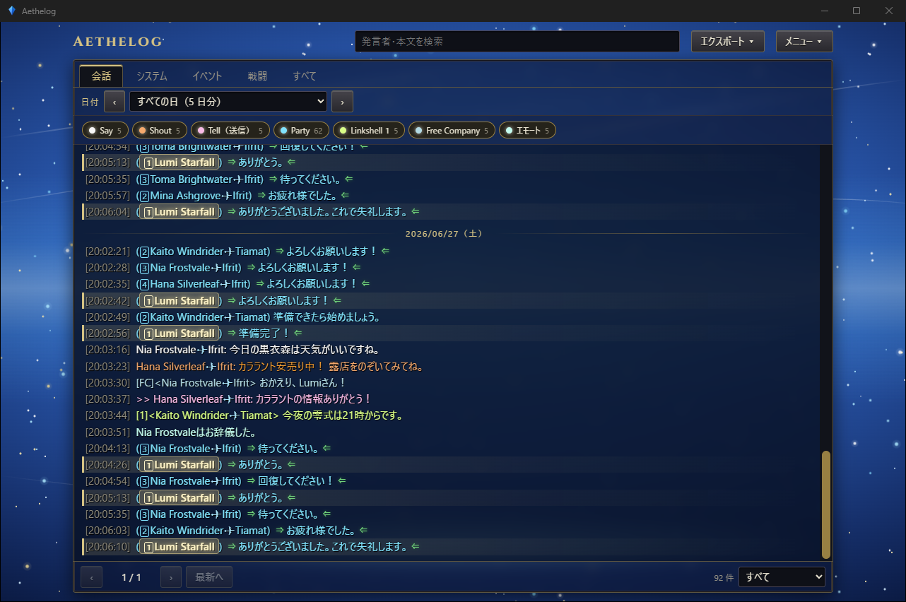
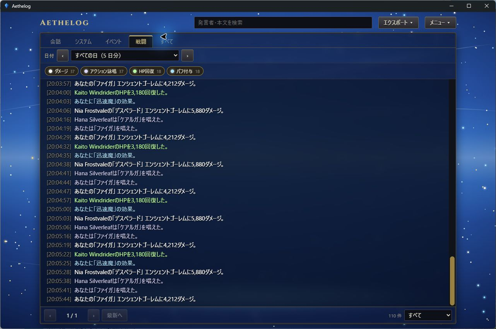
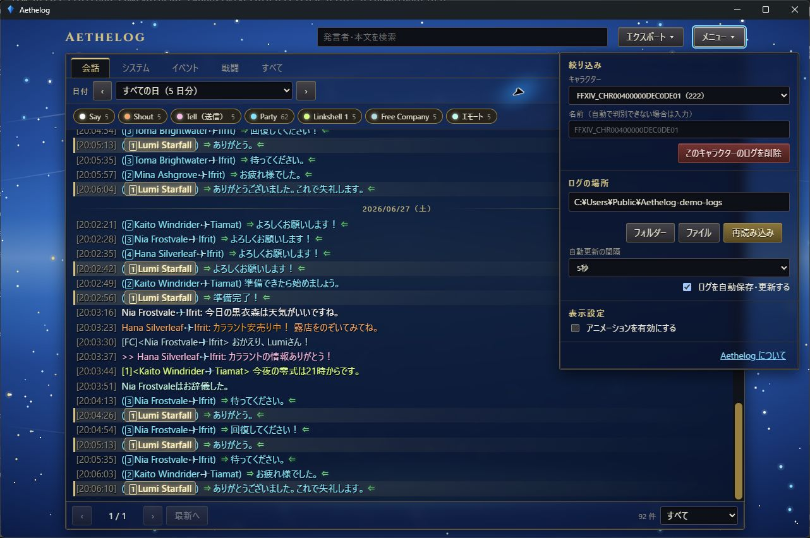

<div align="center">

# Aethelog

**A read-only log viewer for FINAL FANTASY XIV.**

[](https://tauri.app/)
[](https://www.rust-lang.org/)
[](https://vuejs.org/)

**English** · [日本語](README.ja.md)



<sub>Screenshots use made-up characters and a generated demo log (<a href="tools/make_demo_logs.ps1"><code>tools/make_demo_logs.ps1</code></a>).</sub>

</div>

---

## Features

- **Channel filters**: chat, system, event and battle tabs, with a chip for every channel. Double-click a chip to show only that channel.
- **Readable lines**: channel colours, party numbers, icons, links, coloured text and auto-translate phrases.
- **Search**: filter by speaker or message text.
- **Characters and days**: pick a character, then a single day or all days.
- **Export**: save what the filters show as CSV or JSON.
- **Local archive**: the game overwrites its logs, so Aethelog keeps its own copy; logs the game later deletes stay readable.
- **Automatic updates**: watches the selected log location and, whenever the game writes a log, saves the new records to the existing archive stream. Repeated copies of a growing log do not create extra files.
- **Animation settings**: turn background motion, loading animations and transitions on or off. The operating system's reduced-motion preference is also respected.
- **Read-only**: never modifies your logs, and writes nothing but `.csv` / `.json` exports.

## Screenshots

<table>
  <tr>
    <td align="center"><br><sub>Battle tab with per-kind chips</sub></td>
    <td align="center"><br><sub>Menu: character, log location</sub></td>
  </tr>
</table>

## Install

Requires Windows with WebView2 (included in Windows 11), [Rust](https://rustup.rs/) and [Node.js](https://nodejs.org/).

```powershell
npm install --prefix web
powershell -File tools\publish.ps1
```

This builds the app and puts `Aethelog.exe` and `Aethelog_v<version>.zip` in the `artifacts` folder (`tools\publish.bat` does the same; `tools\start.bat` starts the app). `tools\preview.ps1` shows the interface in a browser with sample data, without building the Rust side.

If you plan to commit, see [`AGENTS.md`](AGENTS.md).

## Usage

On start, Aethelog reads every `.log` under the folder you opened last time, or under `Documents\My Games\FINAL FANTASY XIV - A Realm Reborn` on the first run.

Automatic saving and updates are enabled on each launch. Toggle `ログを自動保存・更新する` in the menu to pause or resume. Under `表示設定`, toggle `アニメーションを有効にする`. The animation setting is saved in `userdata/preferences.json` and restored on the next launch. Aethelog is notified when the game writes a log, and also checks the location once a minute in case a notification is missed. Updates appear only after the game writes to disk: the game writes a log file when it holds 1,000 lines or when you log out, so Aethelog cannot display chat that the game has not saved yet. New game log sessions create new archive streams, while additional lines in the same session are appended without duplicate snapshots. Filters and the reading position are kept during automatic updates; the latest lines stay in view while following the end of the list. Deleting a character's archive pauses automatic updates so the remaining game logs are not immediately imported again. Re-enabling updates or reloading imports them again.

- **Menu** (`メニュー`): choose the character, change the log location (folder, file or drag and drop), reload, or delete a character's archived logs (the game's own logs are never touched).
- **Export** (`エクスポート`): saves everything the current filters match as CSV (UTF-8 with BOM) or JSON.
- **Player names**: Ctrl+click on a name opens it on the Lodestone in your browser.
- **Character names**: the logs do not contain your own name, so Aethelog guesses it from party chat. You can type a name in the menu.
- **Data**: the archive, names and preferences are kept in `userdata` next to `Aethelog.exe`.

## Try it with demo logs

No FFXIV install needed to look around. Generate the fictional demo logs and point Aethelog at them:

```powershell
powershell -File tools\make_demo_logs.ps1
$env:AETHELOG_LOGS = "docs\demo-logs"
$env:AETHELOG_DATA = "$env:TEMP\aethelog-demo"   # keeps the demo apart from your real archive and names
artifacts\Aethelog.exe
```

The interface is in Japanese.

## Disclaimer

Aethelog is an unofficial fan-made tool. It is not affiliated with or endorsed by SQUARE ENIX. FINAL FANTASY XIV, the Lodestone and all related game content and images are the property of SQUARE ENIX.

FINAL FANTASY XIV © SQUARE ENIX

## License

MIT. See [LICENSE](LICENSE). The license covers the Aethelog source code only, not the game content it displays. Third-party licences are listed in [`THIRD-PARTY-NOTICES.txt`](THIRD-PARTY-NOTICES.txt) and in the app (`Aethelog について`).
